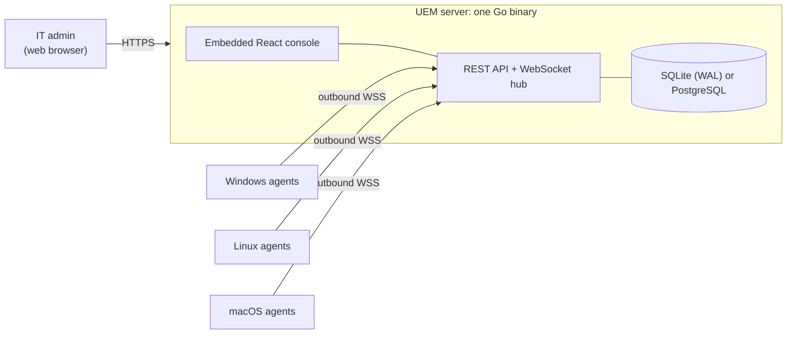

<div align="center">

# UEM: Open-Source, Self-Hosted Endpoint Management

### Remote desktop, patch management, software deployment and IT asset inventory for Windows, Linux and macOS, in a single Go binary.

[](https://github.com/henokakunemail-stack/UEM/releases/latest)
[](https://github.com/henokakunemail-stack/UEM/actions/workflows/ci.yml)
[](go.mod)
[](LICENSE)
[](https://github.com/henokakunemail-stack/UEM/stargazers)

[Features](#features) · [Quick start](#quick-start) · [Install agents](#install-the-agent) · [Architecture](#architecture) · [Configuration](#configuration) · [Docs](#documentation) · [FAQ](#faq)

</div>

---

**UEM** is a free, open-source **Unified Endpoint Management (UEM)** and **RMM** platform you host yourself. One server binary with an embedded web console manages your whole fleet: see every device's hardware and software, push software, patch Windows/Linux/macOS, enforce security policies, open a remote desktop or shell, and roll out agent updates in waves. No per-device licence, no cloud account, and **no inbound ports on your branch networks**: agents only make outbound HTTPS/WebSocket connections.

> ⭐ **If UEM saves you time, please star the repository.** It helps other IT teams find it.

## Why UEM?

- **Self-hosted and private.** Your inventory, credentials and audit trail stay on your own server. SQLite by default; PostgreSQL when you need it.
- **One binary, nothing else to run.** The React console is embedded in the Go server. No separate web server, queue or cache.
- **Pure Go, zero CGO.** Server and agent cross-compile for Windows, Linux and macOS (amd64 and arm64).
- **Built for branch offices.** Agents connect out over TLS WebSockets with jittered reconnects, so NAT and firewalls need no port forwarding.
- **Safe agent updates.** Signed (ed25519) release manifests, SHA-256 checks, staged rollout campaigns with batch size and stagger, and automatic rollback.
- **Mass deployment ready.** Multi-device enrollment tokens, a silent Windows installer, a GPO startup script, a one-line Linux installer and a macOS `.pkg`.
- **Tamper-evident audit trail.** Every admin action is written to a SHA-256 hash chain that the server can verify.
- **Tested.** Around 1,000 Go tests plus 16 end-to-end scripts that drive the real server and agent binaries.

## Features

| Area | What you get |
|---|---|
| **Device inventory** | Online/offline status, CPU, RAM, disks, network adapters, serial number, installed software, Active Directory / Entra ID domain membership. Filter by status, site, group and agent version. |
| **Remote desktop** | Live screen and keyboard/mouse control in the browser, with clipboard and multi-monitor on Windows. |
| **Remote shell** | Interactive terminal in the browser: PowerShell or cmd on Windows, bash/zsh/sh on Linux and macOS. One-off remote commands too. |
| **Patch management** | Scan and install OS updates through Windows Update (WUA), apt/dnf/yum and macOS `softwareupdate`, with reboot handling. |
| **Software deployment** | Silent installs of MSI, EXE, PowerShell, DEB, RPM, PKG and shell scripts, SHA-256 verified, with uninstall by name. |
| **System policies (GPO-style)** | USB storage block, wallpaper, screen lock, screensaver, Windows Update mode, firewall and Defender settings, blocked admin tools, and a managed local administrator account. |
| **Network & web filter** | Domain blacklist (hosts file plus firewall rules) or whitelist mode (local DNS resolver). |
| **IT asset & licence management** | Hardware assets with cost, purchase date and warranty; software licences with seat counts and compliance. Owners synced from LDAP / Active Directory. |
| **Task scheduler** | Script library with SHA-256 integrity and recurring scheduled runs across groups of devices. |
| **Alerts** | Low disk, device offline and critical patch rules, delivered to any webhook. |
| **Reports** | Inventory, patch, deployment and audit reports as CSV or JSON. |
| **Agent self-update** | Import the agents bundled with the server, then roll them out in waves; failures are reported per device. |
| **Access control** | Viewer, technician and admin roles, login rate limiting and account lockout, short-lived access tokens with server-side refresh sessions. |
| **Backup & restore** | Scheduled SQLite snapshots with retention, plus download, upload and restore from the console. |
| **Console** | Dark and light themes, English and Bahasa Indonesia. |

### Platform support

| Capability | Windows | Linux | macOS |
|---|:---:|:---:|:---:|
| Inventory, remote commands, terminal | ✅ | ✅ | ✅ |
| Patch management | ✅ | ✅ (apt, dnf, yum) | ✅ |
| Software deployment | ✅ | ✅ | ✅ (install; uninstall removes the receipt only) |
| Remote desktop | ✅ | ✅ X11 (not Wayland) | ❌ not yet |
| Network filter | ✅ | ✅ | ⚠️ blacklist via hosts file only |
| System policies | ✅ all | ⚠️ USB block, managed admin | ⚠️ managed admin |
| Agent self-update | ✅ | ✅ | ✅ |

## Architecture



- **Server:** Go modular monolith (chi, sqlx). SQLite uses `modernc.org/sqlite`, so no C toolchain is needed.
- **Agent:** a small Go service (Windows service, systemd unit or launchd daemon) that keeps one outbound WebSocket to the server.
- **Console:** React 19, TypeScript and Vite, built into `server/cmd/server/dist` and embedded with `go:embed`.

## Quick start

Download everything from the [latest release](https://github.com/henokakunemail-stack/UEM/releases/latest). Each release ships the server and agents for every platform, plus `checksums.txt`.

### Linux server

```bash
curl -fsSLO https://github.com/henokakunemail-stack/UEM/releases/latest/download/endpoint-server-linux-amd64.tar.gz
tar -xzf endpoint-server-linux-amd64.tar.gz
sudo ./install-server.sh :8443 'choose-an-admin-password'
```

This installs the `endpoint-mgmt-server` systemd service on port 8443. Use `endpoint-server-linux-arm64.tar.gz` on ARM.

### Windows server

Run **`EndpointServer-Setup.exe`** as Administrator. It installs a Windows service listening on port 8443.

### Docker Compose

```bash
git clone https://github.com/henokakunemail-stack/UEM.git && cd UEM
export JWT_SECRET="$(openssl rand -hex 32)"
export ADMIN_PASSWORD='choose-an-admin-password'
docker compose up -d --build
```

The image is built locally from `Dockerfile.server` (distroless, data in the `endpoint-data` volume). Always set `JWT_SECRET` and `ADMIN_PASSWORD`: the compose file's fallbacks are placeholders.

### First login

Open `http://<server>:8443` and sign in as **`admin`** with the password you chose. If you did not set one, a random password is printed once in the server log. For production, put the server behind HTTPS: set `TLS_CERT_FILE` and `TLS_KEY_FILE`, or use the [nginx and Caddy templates](deploy/reverse-proxy/).

## Install the agent

In the console, go to **Devices → Generate Enrollment Token**. A multi-device token can enroll a whole fleet and assigns its site to every machine.

| Platform | How |
|---|---|
| **Windows (GUI)** | Run `EndpointAgent-Setup.exe` and enter the server URL and token. |
| **Windows (silent)** | `EndpointAgent-Setup.exe /S /SERVER="https://uem.example.com" /TOKEN="<TOKEN>" /SITE="HQ"` (keep the quotes) |
| **Windows (Active Directory / GPO)** | Use the startup script in [`packaging/windows/gpo/`](packaging/windows/gpo/) and follow the [GPO deployment guide](docs/installation/agent-gpo.md). |
| **Linux** | `curl -fsSL https://uem.example.com/install/linux.sh \| sudo bash -s -- --server https://uem.example.com --token <TOKEN> --site HQ` |
| **macOS (Intel and Apple Silicon)** | Install `EndpointAgent-macOS.pkg`, then run `sudo endpoint-agent -server https://uem.example.com -enroll <TOKEN> -enroll-only -creds /etc/endpoint-agent/creds.json`. |

Re-running an installer on an enrolled machine keeps its identity, so it does not use up a token. Once enrolled, agents are kept current from **Agent updates** in the console; you do not need to redeploy installers.

## Updating

**Server (Linux).** Run the updater. It backs up the database, swaps the binary, checks `/healthz`, and rolls back if the new version does not start:

```bash
curl -fsSL https://raw.githubusercontent.com/henokakunemail-stack/UEM/main/update.sh | sudo bash
```

Add `-s -- --from-source` to build from the `main` branch instead of the latest release (this requires Go).

**Agents.** Go to **Agent updates → Import from Server Pack**, then launch a campaign to the new version. Choose a batch size and stagger interval to spread the downloads over time. Devices already on the target version are skipped, so you can re-run a campaign to retry the devices that failed.

## Configuration

The server reads environment variables. On Linux they live in `/etc/endpoint-mgmt-server/server.env`.

| Variable | Default | Purpose |
|---|---|---|
| `HTTP_ADDR` | `:8443` | Listen address. |
| `JWT_SECRET` | none (required) | Token signing secret, at least 32 characters. |
| `ADMIN_PASSWORD` | random, printed once | Password of the initial `admin` account. |
| `DB_PATH` | `data/endpoint-mgmt.db` | SQLite database file. |
| `DB_DRIVER` / `DB_URL` | SQLite | Set `DB_DRIVER=postgres` and `DB_URL=postgres://...` to use PostgreSQL. |
| `TLS_CERT_FILE` / `TLS_KEY_FILE` | none | Serve HTTPS directly instead of behind a reverse proxy. |
| `TRUSTED_PROXIES` | none | Reverse proxies whose `X-Forwarded-For` is trusted. |
| `ALLOWED_ORIGIN_DOMAINS` | none | Extra origins allowed to call the API (CORS). |
| `BACKUP_INTERVAL` / `BACKUP_RETAIN` | `1h` / `24` | Automatic SQLite snapshot schedule and how many to keep. |
| `LDAP_BIND_PASSWORD` | none | Bind password for LDAP / Active Directory directory sync. |
| `LOG_LEVEL` / `LOG_FILE` | `info` / stdout | Logging. |

## Build from source

Requirements: **Go 1.26.8+** and, for the console, **Node.js 22+** (CI uses 24).

```bash
# Web console (built into server/cmd/server/dist for embedding)
cd web-console && npm ci && npm run build && cd ..

# Server and agent, CGO-free
CGO_ENABLED=0 go build -ldflags="-s -w" -o endpoint-server ./server/cmd/server
CGO_ENABLED=0 go build -ldflags="-s -w" -o endpoint-agent ./agent/cmd/agent

# Cross-compile, e.g. the Windows agent
CGO_ENABLED=0 GOOS=windows GOARCH=amd64 go build -ldflags="-s -w" -o agent-windows-amd64.exe ./agent/cmd/agent
```

Run the tests:

```bash
CGO_ENABLED=0 go test ./...
cd web-console && npm test
```

The full release (NSIS installers, tarballs and macOS package) is built by [`scripts/build-release.ps1`](scripts/build-release.ps1) and the [release workflow](.github/workflows/release.yml).

## Documentation

- [Installation guides](docs/installation/README.md): server on Linux, Windows and Docker; agents on Windows and Linux; hardware sizing; updates.
- [Mass deployment with Group Policy](docs/installation/agent-gpo.md)
- [How inventory is collected](docs/architecture/inventory-collection.md)
- [PostgreSQL](deploy/README-POSTGRES.md) and [high availability](deploy/README-HA.md)
- [Changelog](CHANGELOG.md)

## Roadmap

These are known gaps. Contributions are very welcome:

- Remote desktop on macOS and on Linux Wayland.
- Cron-style schedules (today schedules run on a fixed interval).
- Email, Slack and Telegram alert channels (today: webhooks).
- Multi-factor authentication for console users.
- PDF reports.

## FAQ

**Is UEM free?**
Yes. It is MIT-licensed, with no device limits and no paid tier.

**Do I need to open ports on my branch offices?**
No. Agents only make outbound connections to the server. Only the server needs to be reachable, usually on 443 behind a reverse proxy.

**Can UEM replace Group Policy for workstation settings?**
For the settings it covers (USB storage, wallpaper, screen lock, Windows Update, firewall, Defender, blocked tools and a managed local admin), yes, including on machines that are not domain-joined. It does not replace Active Directory itself, and it can deploy its own agent through GPO.

**How do I know an update or remote session was legitimate?**
Agent releases are checked against SHA-256 and a signed manifest before they are installed. Every admin action, including remote sessions, is written to the audit trail, and the audit chain can be verified.

**What does it run on?**
The server runs on Linux, Windows or macOS (amd64/arm64), or in Docker. Agents run on Windows 10/11 and Server, mainstream Linux distributions with systemd, and macOS on Intel and Apple Silicon.

## Contributing

Bug reports, feature ideas and pull requests are welcome. See [CONTRIBUTING.md](CONTRIBUTING.md). To report a vulnerability privately, see [SECURITY.md](SECURITY.md).

If you run UEM in production, opening an issue to tell us about your setup helps us decide what to build next.

## Star history

[](https://star-history.com/#henokakunemail-stack/UEM&Date)

## License

[MIT](LICENSE)

<sub>Keywords: unified endpoint management, UEM, MDM, RMM, remote monitoring and management, self-hosted, open source, remote desktop, patch management, software deployment, IT asset management, inventory, Group Policy alternative, Windows, Linux, macOS, Go, React.</sub>
